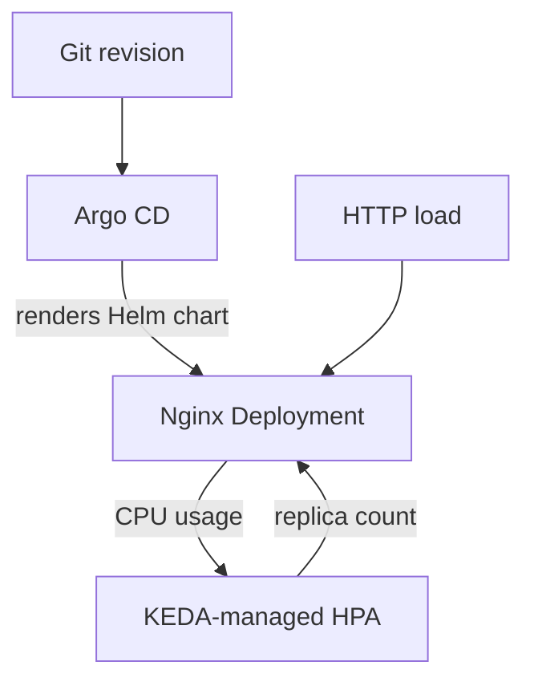

# Kubernetes cloud-native tools lab

Run the lessons from the repository root on a practice cluster. Use Trivy, Helm and kubectl locally. The KEDA lesson needs a working Metrics Server. The Karpenter lesson needs its own EKS setup and can be taught independently.

| Order | Lesson | What learners should observe |
| --- | --- | --- |
| 1 | [Trivy](trivy/README.md) | An image vulnerability report and the optional CI exit status |
| 2 | [Helm](helm/README.md) | A release, a working HTTP endpoint, an upgrade and a rollback |
| 3 | [Argo CD](argocd/README.md) | The chart reconciled from a pushed Git revision |
| 4 | [KEDA](keda/README.md) | A generated HPA and Pod scaling driven by CPU utilization |
| 5 | [Karpenter](karpenter/README.md) | Pending Pods, NodeClaims and new EC2-backed nodes |

## Preflight

```bash
kubectl config current-context
kubectl get nodes
helm version
trivy --version
```

## Teaching sequence

Scan the Nginx version declared by the chart. Finish the Helm lesson by uninstalling its release before creating the Argo CD Application. Run KEDA with the Argo CD walkthrough or with a standalone Helm release, using the matching commands in the lesson. Karpenter uses a separate workload so learners can observe node provisioning without relying on KEDA to create pending Pods.



Trivy reports image findings before deployment. Helm packages resources and can manage a release. Argo CD renders the chart and reconciles the rendered resources. KEDA creates the HPA that adjusts Pod count. Karpenter provisions nodes for Pods the scheduler cannot place on eligible capacity.

## Cleanup order

Use the cleanup block in each lesson. Clean up Karpenter capacity on EKS, then stop the KEDA load and remove the ScaledObject before removing the Argo CD Application or standalone Helm release. Uninstall controllers only when the lab installed them on a dedicated cluster. Karpenter creates billable EC2 instances.
